<p align="center">
  <picture>
    <source media="(prefers-color-scheme: dark)" srcset="public/brand/chrono-logo.png" />
    
  </picture>
</p>

<p align="center">
  <strong>🏆 Winner, Daisy Chain challenge (Intermediate Challenge 06) · Moth Hack 2026</strong>
</p>

<p align="center">
  <strong>Grow a specimen through eight chained stages, then touch it until it ages.</strong><br>
  <sub>Comet QRNG → Quantum Graph → an image edit of the colony seed → Blur → Blur Core → Entanglement Shader → QRC Audio → Retrocausal Echo.</sub>
</p>

<p align="center">
  <a href="https://chrono.bedelau59.chatgpt.site"></a>
  
  
  
  
  
  
</p>

---

## ▍The problem

Challenge 06 scores a project on how many engines it runs, and on whether each output is actually the next input. A row of separate demos does not answer that.

Chrono runs one chain and draws the result as a specimen you can orbit. **Create** grows it. **Touch** queues a decoherence wound. **Evolve** reruns the back half and keeps the genome, the colony, and the membrane. Five finished specimens are committed under `public/specimens/`, so the viewport can open without a new job.

The published site recorded in this repo is [chrono.bedelau59.chatgpt.site](https://chrono.bedelau59.chatgpt.site).

## ▍The pipeline at a glance

```mermaid
flowchart LR
    classDef input fill:#0b0f0e,stroke:#19c37d,color:#e8f3ec,stroke-width:1.5px
    classDef stage fill:#ffffff,stroke:#111,color:#111,stroke-width:1px
    classDef model fill:#111,stroke:#111,color:#fff,stroke-width:1px
    classDef output fill:#19c37d,stroke:#0b3d31,color:#04120d,stroke-width:1.5px

    Q[("12 qubits × 4096 shots")]:::input --> G["00 Genesis<br/>comet-qrng-v1<br/>32-byte genome"]:::stage
    G --> C["01 Colony<br/>graph-v1<br/>32×32 seed PNG"]:::stage
    C --> M["02 Morphogenesis<br/>gpt-image-2.5-flare<br/>behind tessa-image-v1"]:::model
    M --> D["03 Decoherence<br/>blur-v1<br/>skin + wound mask"]:::stage
    D --> S["04 Soma<br/>blur-core-v1<br/>displacement field"]:::stage
    S --> MB["05 Membrane<br/>entanglement-shader-v1<br/>R/T LUTs + GLSL"]:::stage
    MB --> V["06 Voice<br/>qrc-audio-v1<br/>song WAV"]:::stage
    V --> E["07 Echo<br/>retrocausal-echo-v1<br/>the WAV that plays"]:::output
```

A failed stage halts the chain. Downstream stages do not run. Evolve marks genesis, colony, and morphogenesis `cached` and reruns decoherence through echo. `withAudio: false` keeps the voice and echo cached as well.

| # | Stage | What the browser calls | What it hands on |
|---|---|---|---|
| 0 | Genesis | `comet-qrng-v1` | 32-byte genome from Born-rule shot counts. If the extractor returns fewer than 32 bytes, the genome is SHA-256 of the raw counts. |
| 1 | Colony | `graph-v1` | Qubit count `6 + (genome[4] % 5)`, a ring-and-chord coupling map, Bloch vectors, and a 32×32 colony seed PNG. |
| 2 | Morphogenesis | `POST /api/moth/engines/tessa-image-v1/process` | The route downloads the uploaded seed and edits it with OpenAI Images. The PNG is resampled to that seed's dimensions and uploaded to Moth. The panel still labels this stage **Tessa Image**. |
| 3 | Decoherence | `blur-v1` | Aged tissue. The wound mask is a new upload. Skin is passed as the previous `output_asset_id`. |
| 4 | Soma | `blur-core-v1` | A displacement field from a 32×32 luminance grid of the tissue. The shader displaces each point by the local field minus the entanglement-scaled field at the antipode. |
| 5 | Membrane | `entanglement-shader-v1` | Reflectance / transmittance LUTs and a shader. Parameters are derived in `src/lib/chain/membraneParams.ts` and clamped to the engine bounds. |
| 6 | Voice | `qrc-audio-v1` | A reservoir-sequenced song. The chunk vocabulary comes from LUT rows and soma peaks. |
| 7 | Echo | `retrocausal-echo-v1` | A multi-tap echo of that song. This is the file the player uses. |

Each run stores a one-line coupling note with the numbers from that job. Evolution shows the note, the job id, the latency, and the attempts. The membrane note on `public/specimens/3fd5b1/manifest.json` reads `absorption 0.93 ← entropy 7.41 bits · layers 2 ← soma σ 0.148`.

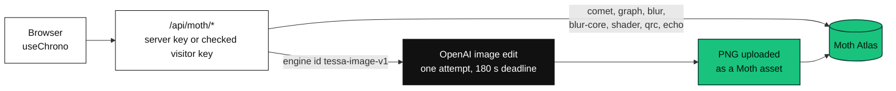

The current pipeline still builds a 16×16 morphogenesis input (`TESSA_INPUT_SIZE`) from the same Bloch vectors as the 32×32 colony, and it still sends `machine` and `shots` on that request. The OpenAI handler reads `input_files.image`. It does not apply the Tessa machine or shot count. Ideal / IBM Fez still appears in the panel. Receipts record `provider: openai` and the model. `OPENAI_IMAGE_MODEL` defaults to `gpt-image-2.5-flare`.

`scripts/grow.ts` does not use this proxy. It submits `tessa-image-v1` to Atlas. That is the historical direct-Moth path. `status.md` records repeated Tessa `engine_timeout` responses near 63 seconds, including after the app-side shot reduction.

### Recorded chain times

These seconds are `latencyMs` on the committed manifests. Morphogenesis in these five files is Tessa, on `aer` unless noted. They are job times from that grow, not a current OpenAI benchmark.

| Stage | 3fd5b1 | 42ac05 | 6a5efd | 308761 (`fake_fez`) |
|---|---:|---:|---:|---:|
| Genesis | 14.8 s | 11.1 s | 9.7 s | 26.4 s |
| Colony | 5.7 s | 5.2 s | 9.0 s | 5.7 s |
| Morphogenesis | 34.1 s | 82.0 s | 89.7 s | 658.1 s |
| Decoherence | 4.5 s | 4.2 s | 4.7 s | 4.2 s |
| Soma | 3.8 s | 4.9 s | 3.9 s | 3.3 s |
| Membrane | 115.3 s | 18.8 s | 206.8 s | 26.1 s |
| Voice | 20.3 s | 17.4 s | 16.3 s | 19.8 s |
| Echo | 10.5 s | 11.1 s | 9.4 s | 12.4 s |
| **Manifest total** | **208.9 s** | **154.7 s** | **349.6 s** | **756.0 s** |

`42ac05-g1` is generation 1 of `42ac05`, with four wounds. Genesis, colony, and morphogenesis are `cached`. The rerun total on that manifest is **55.3 s** (decoherence 4.2, soma 3.2, membrane 18.2, voice 20.6, echo 9.1).

One later localhost Create, Specimen F2C3, is written up in [`docs/OPENAI-MORPHOGENESIS.md`](docs/OPENAI-MORPHOGENESIS.md). The UI-rounded rail on that run was genesis 17 s, colony 5.8 s, morphogenesis 19 s, decoherence 4.8 s, soma 3.7 s, membrane 12 s, voice 20 s, echo 13 s. The document calls these rounded on-screen values from a single image attempt, not a latency guarantee. The still is [`docs/screenshots/openai-image-swap.jpg`](docs/screenshots/openai-image-swap.jpg).

The brief's all-Moth credit sketch is comet 5 + graph 5 + tessa 1 + blur 1 + blur-core 1 + entanglement shader 1 + qrc-audio 5 + echo 2 = 21, and about 10 for an evolve of stages 3–7. A browser Create no longer submits Tessa. This README does not state an OpenAI price.

## ▍Project gallery

<table><tr>
<td width="50%"></td>
<td width="50%"></td>
</tr></table>

<sub>Images from the [project portfolio](https://bede-lau.github.io/); they may depict an earlier build.</sub>

## ▍The demo

Archive specimens render from `public/specimens/`. Picking one does not submit a job. Create and Evolve do.

<p align="center">
  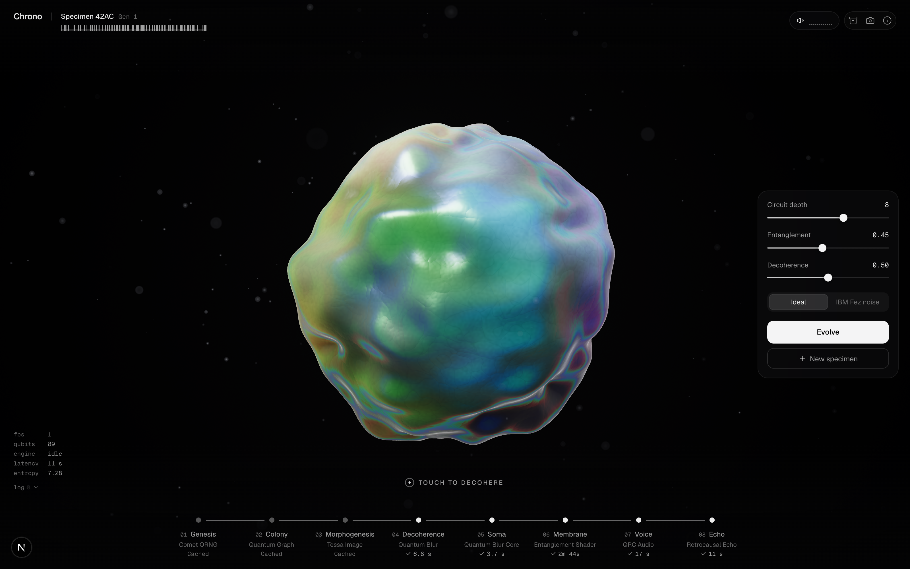
</p>

<table>
  <tr>
    <td width="50%" valign="top">
      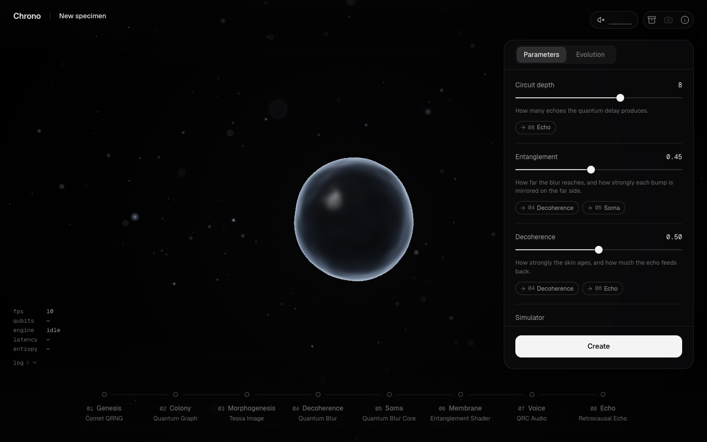<br />
      <strong>00 · New specimen.</strong> First visit is a blank embryo. The archive index loads. Nothing is selected, and nothing runs, until Create.
    </td>
    <td width="50%" valign="top">
      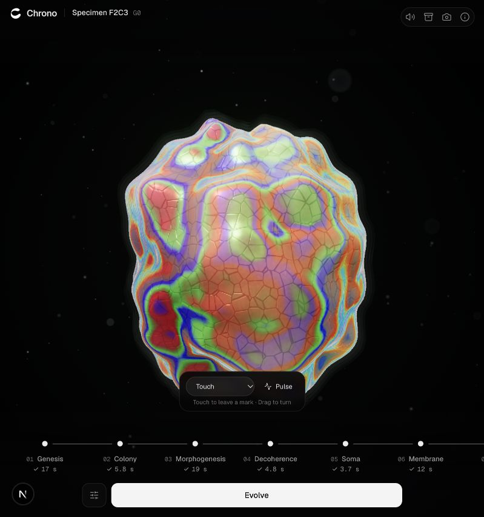<br />
      <strong>01 · Create.</strong> Specimen F2C3, generation 0, from the OpenAI morphogenesis write-up. The rail shows Morphogenesis at 19 s. Touch and Pulse sit on the organism.
    </td>
  </tr>
  <tr>
    <td width="50%" valign="top">
      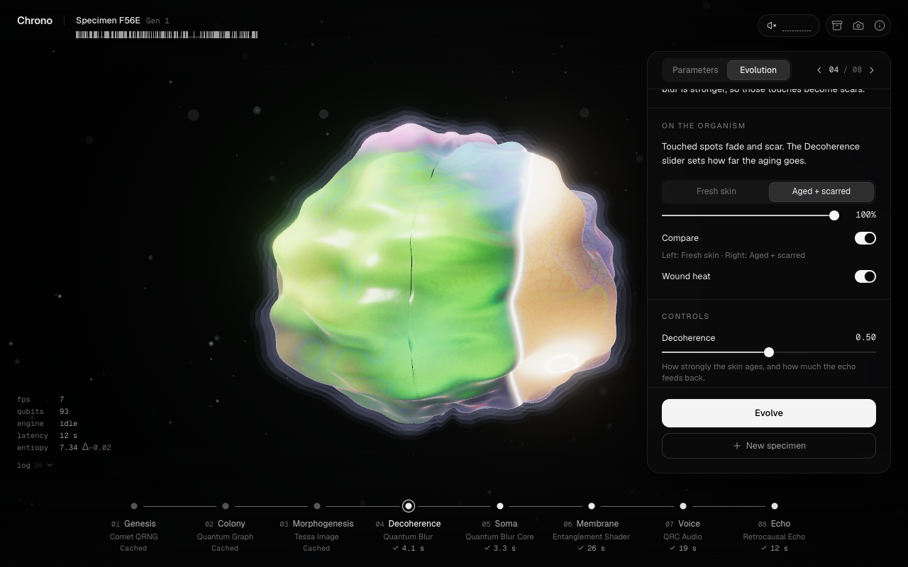<br />
      <strong>02 · Decoherence.</strong> Chrono Lens scrubs Without / With, splits the organism, and can draw a wound-heat overlay.
    </td>
    <td width="50%" valign="top">
      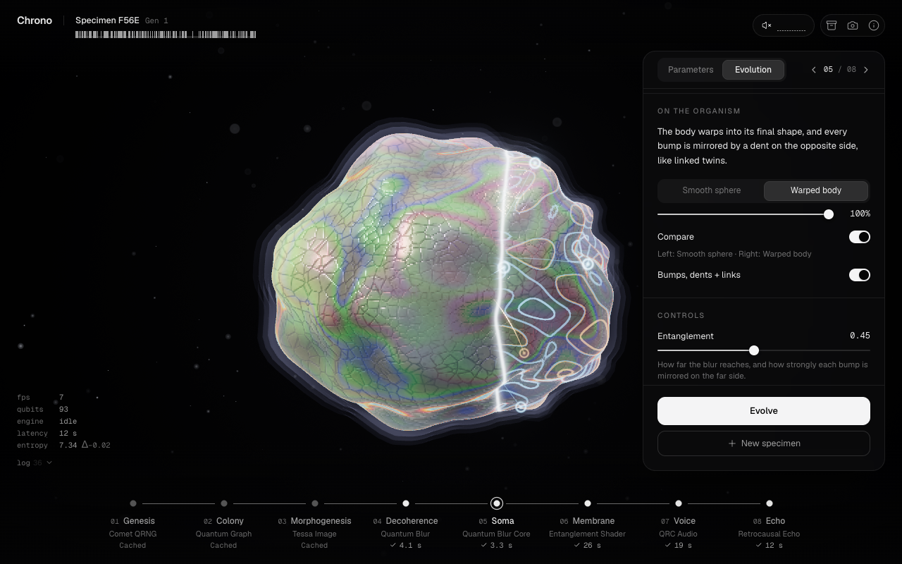<br />
      <strong>03 · Soma.</strong> The same lens isolates the displacement field. Bumps on one side are paired with dents on the other.
    </td>
  </tr>
  <tr>
    <td width="50%" valign="top">
      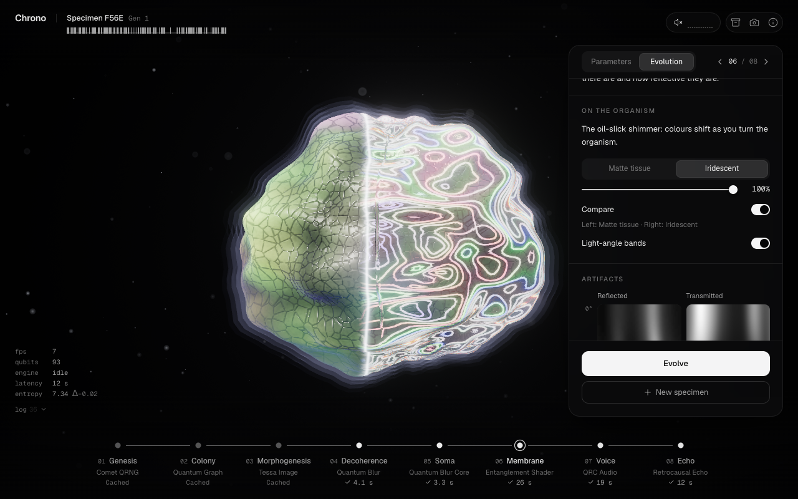<br />
      <strong>04 · Membrane.</strong> Matte tissue against the LUT shader, with reflected and transmitted LUT thumbs in the panel.
    </td>
    <td width="50%" valign="top">
      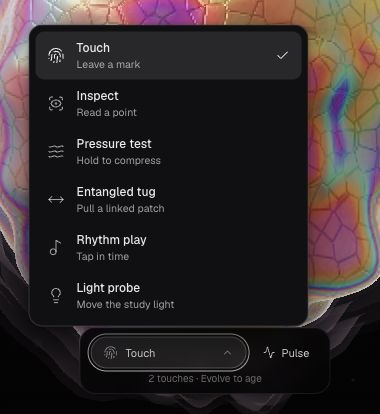<br />
      <strong>05 · Interact.</strong> Touch leaves a mark for a later Evolve. Inspect reads a point. Pressure, tug, rhythm, and light stay local.
    </td>
  </tr>
  <tr>
    <td width="50%" valign="top">
      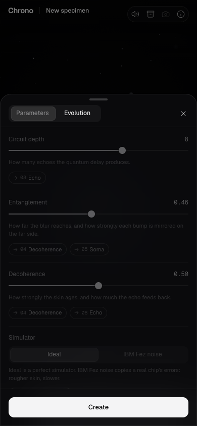<br />
      <strong>06 · Phone.</strong> On a narrow viewport the rail scrolls sideways and Parameters / Evolution sit in a bottom sheet. Create stays pinned. The breakpoint is in <code>src/hooks/useMediaQuery.ts</code>.
    </td>
    <td width="50%" valign="top">
      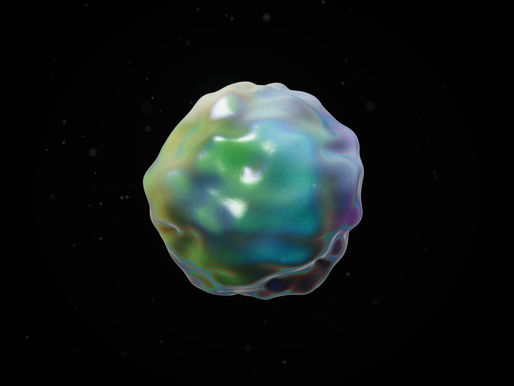<br />
      <strong>Poster.</strong> The 4:3 submission still, <code>docs/poster.png</code>. The same render is <code>deck/assets/organism.png</code>. The pitch deck is <a href="deck/Chrono.pdf"><code>deck/Chrono.pdf</code></a>.
    </td>
  </tr>
</table>

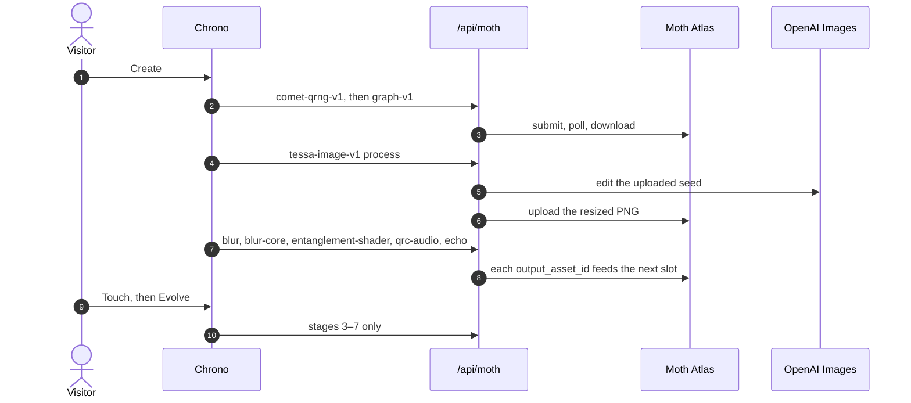

**Controls** (from `src/hooks/useShortcuts.ts` and the info sheet):

| Key | Action |
|---|---|
| Space | Create, Evolve, or resume retained work. In Rhythm play, Space taps the beat. |
| N | New specimen. Parameters stay. Nothing runs until Create. |
| M | Mute. |
| 1–8 | Open that stage in Evolution. |
| ← → | Step the Evolution stage. |
| P | Parameters. |
| Esc | Back, or close the open sheet. |

Touch paints a wound and asks you to Evolve. Inspect pins a read-only point. Pulse stimulates the membrane and does not record a wound. Pressure, entangled tug, rhythm (60–140 BPM), and the light probe change the viewport only. They do not submit jobs. Details: [`docs/INTERACTIONS.md`](docs/INTERACTIONS.md).

## ▍Run it

Node and npm. A WebGL browser. `npm run dev` is `next dev`, which serves [http://localhost:3000](http://localhost:3000).

```sh
git clone https://github.com/bede-lau/chrono && cd chrono
npm install
cp .env.example .env.local
npm run dev
```

| Variable | Where it is read |
|---|---|
| `MOTH_API_KEY` | Server only. Atlas bearer token. Never imported by client code. |
| `MOTH_API_BASE` | Server only. `.env.example` sets `https://api.mothquantum.com/api/v1`. |
| `OPENAI_API_KEY` | Server only. Morphogenesis image edit. A visitor Moth key does not replace it. |
| `OPENAI_IMAGE_MODEL` | Optional. Defaults to `gpt-image-2.5-flare`. |
| `OPENAI_IMAGE_JOB_SECRET` | Server only. Stable random string, at least 32 characters. Signs image-job receipts for seven days. |

`.env.local` is gitignored. Do not commit key values.

**Opening the archive needs no key.** The five specimens are static files. Create and Evolve need a Moth credential: the server key, or a visitor key that has passed **Check key**. Check key is `POST /api/moth/key/check`. It calls Atlas `/me` once, returns Accepted or Rejected, and does not store the key. Accepted keys stay in browser memory and are sent only to the same-origin proxy. A new Create also needs `OPENAI_API_KEY` and `OPENAI_IMAGE_JOB_SECRET` on the server.

| URL | What |
|---|---|
| `/` | The app. Blank embryo, then Create or an archive pick. |
| `/lab/organism` | Viewport sandbox. Lab routes are `noindex`. |
| `/lab/audio` | Audio sandbox. Lab routes are `noindex`. |
| [chrono.bedelau59.chatgpt.site](https://chrono.bedelau59.chatgpt.site) | The public site named in `src/app/layout.tsx`, `status.md`, and `docs/submission.md`. |

### Build, check, grow

```sh
npm run lint
npx next typegen          # once on a fresh checkout; Next 16 generates route types
npx tsc --noEmit -p .
npm run build             # vinext build → Cloudflare Workers bundle
npm run build:next        # next build
npm run start             # next start, after build:next
```

Offline checks that ship in `scripts/`. They do not call Atlas or OpenAI:

```sh
npx tsx scripts/verify-specimens.ts
npx tsx scripts/verify-mask.ts
npx tsx scripts/verify-surface.ts
npx tsx scripts/verify-start-flow.ts
npx tsx scripts/verify-interactions.ts
npx tsx scripts/verify-audio.ts
npx tsx scripts/verify-audio-interactions.ts
npx tsx scripts/verify-membrane-params.ts
npx tsx scripts/verify-morphogenesis.ts
npx tsx scripts/verify-echo-resume.ts
npx tsx scripts/verify-moth-key.ts
npx tsx scripts/verify-openai-images.ts
npx tsx scripts/verify-openai-membrane-job.ts
```

`status.md` records a release pass of these verifiers, plus lint, `tsc`, and the vinext build, on 2026-10-15. Re-run them on a checkout before treating that note as current.

Browser harnesses, pointed at a server you already started:

```sh
node scripts/qa/e2e.mjs http://localhost:3000 /tmp/chrono-e2e
node scripts/qa/brand.mjs http://localhost:3103
node scripts/qa/production.mjs http://localhost:3103 /tmp/chrono-production
```

`e2e.mjs --live` spends credits. `status.md` puts that at about 31 credits for a real Create plus Evolve. Brand and production smokes are written to avoid engine calls. `node scripts/generate-brand.mjs` rewrites the files in `public/brand/` from the SVG master.

Direct Atlas grow. This path still calls Tessa, and recent retests in `status.md` timed out:

```sh
npx tsx --env-file=.env.local scripts/grow.ts [--machine aer|fake_fez] [--depth 8] [--entanglement 0.45] [--decay 0.5]
npx tsx --env-file=.env.local scripts/grow.ts --evolve 42ac05 --wounds 4
npx tsx --env-file=.env.local scripts/grow.ts --resume <id>
```

Use **Create** in the browser for the OpenAI morphogenesis path.

Deck export, from the script in `deck/export.sh`. It writes `deck/Chrono.pdf` and `deck/previews/slide-N.png`. The script comment says 4 pages at 1920×1080. `USE_DIA=1` opts into headless Dia, which hangs if Dia is already open.

```sh
bash deck/export.sh
```

Hosting config for the Workers bundle is `vite.config.ts` and `.openai/hosting.json`. On a Next host, set the build command to `npm run build:next` and set the five variables above as server environment. The proxy routes are `src/app/api/moth/assets`, `assets/[assetId]/download`, `engines/[engineId]/process`, `jobs/[jobId]/status`, `jobs/[jobId]/result`, and `key/check`.

## ▍Repository map

```
chrono/
├── src/app/page.tsx                 # home
├── src/app/layout.tsx               # metadata, Geist, canonical URL
├── src/app/lab/organism             # viewport sandbox
├── src/app/lab/audio                # audio sandbox
├── src/app/api/moth                 # Atlas proxy + OpenAI morphogenesis route
├── src/components/organism          # react-three-fiber scene, lens, shaders
├── src/components/audio             # toggle, spectrum, waveform, playback
├── src/components/ui                # rail, panel, archive, probes, telemetry
├── src/lib/chain                    # types, pipeline, controller, membrane params
├── src/lib/moth                     # transport, proxy, job polling
├── src/lib/openai                   # image edit + signed job receipts
├── src/lib/imaging                  # PNG, colony seed, wound mask, HDR LUT, shader zip
├── src/lib/audio                    # WAV, playback, rhythm voices
├── src/lib/store.ts                 # useChrono
├── public/specimens                 # five committed specimens + index.json
├── public/brand                     # mark, lockup, icons, social card
├── scripts/grow.ts                  # direct Atlas grow / evolve / resume
├── scripts/verify-*.ts              # offline checks
├── scripts/qa                       # browser harnesses
├── deck/Chrono.pdf                  # pitch deck
└── docs                             # brief, PRD, submission, QA notes
```

| Doc | |
|---|---|
| [`docs/BRIEF.md`](docs/BRIEF.md) | Build brief: chain, API facts, UX, ownership |
| [`docs/PRD.md`](docs/PRD.md) | PRD revised against the real Atlas API |
| [`decisions.md`](decisions.md) | Architecture decisions D1–D13 |
| [`status.md`](status.md) | Handover log, measured runs, known Tessa failures |
| [`docs/submission.md`](docs/submission.md) | Historical Challenge 06 entry. Describes eight Moth engines and Tessa skins |
| [`docs/OPENAI-MORPHOGENESIS.md`](docs/OPENAI-MORPHOGENESIS.md) | The live image-edit stage, and the one recorded Create |
| [`docs/INTERACTIONS.md`](docs/INTERACTIONS.md) | Local experiments: pressure, tug, rhythm, light |
| [`docs/BRAND.md`](docs/BRAND.md) | Mark, icons, social card, how to regenerate them |
| [`docs/ROUND2.md`](docs/ROUND2.md) | Round 2 product pass |
| [`AGENTS.md`](AGENTS.md) | Contract rules for anyone editing the chain |

State lives in `useChrono`. The organism and the audio widgets read the store. Contracts in `src/lib/chain/types.ts` and `src/lib/store.ts` are additive-only.

## ▍What this is, and isn't

We'd rather be precise than impressive.

- A new Create's membrane is an OpenAI image edit of the colony seed, resized and uploaded to Moth. The five archived skins were produced by Tessa's encode / measure / decode path. `308761` used the `fake_fez` noise model for that stage and took 658.1 s.
- The Evolution label for morphogenesis still says Tessa Image, and the pipeline note still describes a colour-sphere encode. The Ideal / IBM Fez control and the shot count are still sent. The OpenAI route does not use them. Backend receipts store the provider, the model, and the request id.
- `scripts/grow.ts` still submits Tessa to Atlas. Treat it as a paid, currently unreliable path. The browser Create is the path that matches the running app.
- There is no local stand-in image. If the edit or a later engine fails, the chain stops. OpenAI provider errors are not auto-retried. A manual retry can spend another image call.
- Echo resume keeps the same Atlas job id in memory. A reload drops it. Image-job receipts are signed and last seven days; they are scoped to the Moth base URL and the credential that created them.
- The render budget in the brief is a target: 30 fps with a specimen, 15 fps on the blank embryo, device pixel ratio capped at 1.5, a 160×100 sphere, MSAA 2, and a pause while the tab is hidden. `status.md` says this is not a measured frame-rate guarantee.
- Pressure, tug, rhythm, and light are local and reversible. Touch is the interaction that queues a wound.
- Headless screenshots in this repo were captured with software WebGL. They are not a GPU benchmark. Membrane latency on the archived jobs already spans 18.8 s to 206.8 s. Atlas queue time sits outside the app.
- The proxy whitelist also names `deep-fryer-v1` and `telablur-v1`. The chain does not call them.
- No `LICENSE` file is committed. The previous README stated MIT.

## ▍Credits

| | |
|---|---|
| Challenge | Moth Hack 2026 · Intermediate · Challenge 06, Daisy Chain |
| Engines | [Moth Atlas](https://www.mothquantum.com): `comet-qrng-v1`, `graph-v1`, `blur-v1`, `blur-core-v1`, `entanglement-shader-v1`, `qrc-audio-v1`, `retrocausal-echo-v1`. Archived specimens also used `tessa-image-v1`. |
| Morphogenesis | OpenAI Images, model `gpt-image-2.5-flare` unless `OPENAI_IMAGE_MODEL` overrides it |
| 3D | [Three.js](https://github.com/mrdoob/three.js), React Three Fiber, drei, postprocessing |
| App | Next.js 16.3, React 19.2, TypeScript 5, Zustand 5, Tailwind CSS 4, Motion, Geist |
| Imaging and audio | fast-png, fflate, Web Audio |
| Identity | `public/brand/`, documented in `docs/BRAND.md`. The mark was redrawn as SVG after a generated bitmap concept. |
| Code | Written with Claude Code (Opus, Sonnet, Haiku) and Codex agents, as recorded in `docs/submission.md` and `AGENTS.md` |
| Licence | MIT, as previously stated. No `LICENSE` file is in the tree. |

<p align="center">
  <sub>Winner, Daisy Chain challenge (Intermediate Challenge 06) · Moth Hack 2026.</sub>
</p>
