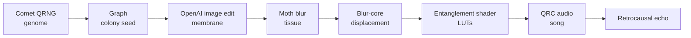

<h1 align="center">Chrono</h1>
<p align="center"><b>Grow, touch and evolve a quantum-inspired organism in the browser.</b></p>

## ▍At a glance



The current chain uses seven Moth stages and one OpenAI image-edit stage; the historical competition submission used a different image provider.

---

A living, evolving organism in the browser, grown through a chain of **seven Moth Atlas engines and one OpenAI image-edit stage**. The OpenAI stage edits the real Colony seed; its image is uploaded to Moth and consumed by the remaining Moth stages. The original competition submission targeted **Moth Hack 2026 · Intermediate · Challenge 06 "Daisy Chain"**; the current image provider differs from that historical submission.

**Live demo:** [chrono.bedelau59.chatgpt.site](https://chrono.bedelau59.chatgpt.site)

**Visual identity:** [Logo assets, icon exports and metadata](docs/BRAND.md). Regenerate the brand exports with `node scripts/generate-brand.mjs`; verify the built site's branding with `node scripts/qa/brand.mjs http://localhost:3103`.

---

## The Current Generation Chain

| # | Stage | Engine | Consumes | Produces |
|---|---|---|---|---|
| 0 | Genesis | `comet-qrng-v1` | Born-rule measurements (12 qubits × 4096 shots) | 32-byte **genome** |
| 1 | Colony | `graph-v1` | Genome → seed + coupling topology | 32×32 **colony seed PNG** |
| 2 | Morphogenesis | OpenAI `gpt-image-2.5-flare` behind the existing `tessa-image-v1` browser endpoint | Colony seed PNG | **generated membrane** PNG, normalized and uploaded as a Moth asset |
| 3 | Decoherence | `blur-v1` | Skin + wound mask | **aged tissue** PNG |
| 4 | Soma | `blur-core-v1` | Tissue luminance grid | **displacement field** (vertex warping) |
| 5 | Membrane | `entanglement-shader-v1` | Tissue entropy/params | **R/T LUTs** + iridescent shader |
| 6 | Voice | `qrc-audio-v1` | LUT vocabulary + soma peaks | reservoir-sequenced **song** WAV |
| 7 | Echo | `retrocausal-echo-v1` | Song | quantum multi-tap **echo** WAV |

---

## How It Works

1. **Genesis**: Comet QRNG extracts a 32-byte genome from Born-rule quantum measurements.
2. **Genetic landscape**: Graph engine seeds a quantum circuit (6–10 qubits) with genome bits, measures Bloch vectors (nuclei) and ZZ coupling (membrane blueprint), outputs a colony seed PNG.
3. **Morphogenesis**: OpenAI edits a reference derived from the actual Colony seed. The result is resized to the seed dimensions and uploaded to Moth for downstream processing. This is model-generated imagery, not Tessa quantum encoding.
4. **Aging & wounds**: Blur applies entanglement-driven diffusion; user clicks paint wounds (local decoherence). Tissue accumulates age + wounds.
5. **Spatial warp**: Blur-Core outputs a displacement grid; vertex shader applies sign-flipped offsets to antipodal mesh vertex pairs (simulating non-local entanglement).
6. **Iridescence**: Entanglement Shader generates R/T LUTs from tissue entropy/hue. LUTs drive a custom membrane shader (Fresnel + interference patterns).
7. **Sonification**: QRC Audio vocoder derives a vocabulary from LUT rows (each row → pitch/timbre slot). Seeds with genome bits, modulates by entanglement strength. Result: a song unique to this organism.
8. **Quantum echo**: Retrocausal Echo applies multi-tap quantum delay (n_sites = num qubits, depth from circuit) to the song. What the user hears is this echo.

**Interact**: Start at **New specimen** and press **Create** to grow one, or load one from Archive. The interaction selector offers Touch, Inspect, Pressure test, Entangled tug, Rhythm play and Light probe, alongside a separate Pulse action. Touch paints decoherence wounds for a future Evolve; local experiments change the viewport response without submitting jobs or changing artifacts. The shared **Parameters | Evolution** panel explains stages and includes the Chrono Lens.

---

## Quickstart

```bash
# Install dependencies
npm install

# Create .env.local with Moth and OpenAI server credentials
cp .env.example .env.local
# Set MOTH_API_KEY, OPENAI_API_KEY, and a stable random
# OPENAI_IMAGE_JOB_SECRET of at least 32 characters.

# Start dev server
npm run dev

# Open http://localhost:3000
# The app opens at New specimen; press Create, or choose a specimen from the archive
```

**Historical direct-Moth CLI:** This bypasses the browser proxy and still calls Tessa; use the browser's Create action for OpenAI Morphogenesis.
```bash
npx tsx --env-file=.env.local scripts/grow.ts
```

---

## Project Structure

```
Chrono/
├── src/
│   ├── app/
│   │   ├── page.tsx                # Home page (main layout)
│   │   ├── layout.tsx              # App layout, metadata
│   │   ├── globals.css             # Global styles (Tailwind)
│   │   └── api/moth/               # Proxy routes for Moth API
│   │       ├── upload/
│   │       ├── submit/
│   │       ├── status/
│   │       └── result/
│   ├── lib/
│   │   ├── chain/
│   │   │   ├── types.ts            # Specimen, Pipeline, Engine contracts
│   │   │   └── controller.ts       # Lifecycle orchestration (grow, evolve)
│   │   ├── moth/
│   │   │   └── transport.ts        # API client (asset upload, job submit/poll)
│   │   ├── imaging/
│   │   │   └── index.ts            # Texture decode/encode (PNG, LUT heatmaps)
│   │   ├── audio/
│   │   │   └── index.ts            # Waveform analysis, playback
│   │   └── store.ts                # Zustand store (useChrono)
│   ├── components/
│   │   ├── organism/
│   │   │   ├── Organism.tsx        # Three.js 3D viewport
│   │   │   └── shaders/            # Vertex, fragment, membrane shaders
│   │   ├── audio/
│   │   │   ├── AudioToggle.tsx     # Play/mute button
│   │   │   ├── Spectrum.tsx        # Live spectrum analyzer
│   │   │   └── Waveform.tsx        # Waveform display for voice/echo
│   │   └── ui/
│   │       ├── ChainRail.tsx       # 8-node chain status rail
│   │       ├── RightPanel.tsx      # Parameters and Evolution views
│   │       ├── Controls.tsx        # Sliders + buttons
│   │       ├── Telemetry.tsx       # FPS, qubits, latency, log
│   │       └── ...
│   └── hooks/
│       └── useAudioEngine.ts       # Audio playback controller
├── scripts/
│   └── grow.ts                     # CLI: spawn a new specimen end-to-end
├── public/
│   └── specimens/                  # Pre-grown specimen archives (JSON snapshots)
├── deck/                           # Pitch deck (PDF export)
│   ├── assets/
│   └── previews/
├── docs/
│   ├── BRIEF.md                    # Orchestrator brief (read first)
│   ├── PRD.md                      # PRD v2 (refined, this project's spec)
│   └── moth/
│       ├── openapi.json            # Moth Atlas API schema
│       ├── fixtures/               # Example API responses
│       └── hack-event.ts           # Challenge 06 context
├── decisions.md                    # Architecture decision records (D1–D13)
├── status.md                       # Project status & handover guide
├── AGENTS.md                       # Agent ownership & contracts
├── CLAUDE.md                       # User's global instructions
├── README.md                       # This file
├── package.json                    # Dependencies (Next 16.3, React 19.2, three, zustand)
├── tsconfig.json
├── tailwind.config.ts
└── next.config.ts
```

---

## Tech Stack

- **Framework**: Next.js 16.3 (App Router), React 19.2, TypeScript 5
- **Styling**: Tailwind CSS 4, Geist fonts
- **3D Rendering**: three.js 0.186, @react-three/fiber 9, drei 10, @react-three/postprocessing 3
- **State**: zustand 5
- **Animation**: motion 13
- **Utilities**: fflate (ZIP), fast-png (PNG encode/decode), lucide-react (icons), tsx (CLI)

---

## Moth Atlas Engines

The current chain uses seven Moth Atlas engines publicly documented at [mothquantum.com](https://www.mothquantum.com):

- **Comet QRNG**: Born-rule quantum random extraction
- **Quantum Graph**: Bloch sphere tomography + circuit topology design
- **Blur**: Quantum-walk diffusion (decoherence simulation)
- **Blur-Core**: Topology-preserving displacement field
- **Entanglement Shader**: BSDF LUT generation (R/T reflectance/transmittance)
- **QRC Audio**: Quantum reservoir computing for audio synthesis
- **Retrocausal Echo**: Multi-tap quantum delay effect

---

## UI/UX

**Design**: Black stage (`#050506`), organism is the only colour. Hairline UI, Geist Sans, and Geist Mono for telemetry. Concise plain-English engine explanations appear in Evolution. **Motion**: 200–400 ms ease-out.

**Desktop layout**:
- **Top-left**: Wordmark, specimen identity, genome barcode.
- **Top-right**: Audio toggle (with spectrum), archive, capture, info.
- **Right**: One Parameters | Evolution panel. Parameters has Circuit Depth, Entanglement, Decoherence and machine controls; Evolution has engine explanations, the Chrono Lens, artifact preview and run details. Footer action reads Create when blank and Evolve when a specimen is loaded.
- **Bottom**: Daisy chain rail (8 nodes, linked line, status indicators, clickable).
- **Evolution view**: Stage selection switches the shared panel immediately and links the engine’s artifact to its visible effect on the organism.
- **Bottom-left**: Telemetry (FPS, qubits, active engine, entropy Δ), expandable log.

**Mobile** (<768 px): Horizontally scrollable chain rail, one Parameters | Evolution bottom sheet, and a pinned primary action.

**Interaction**:
- **Space**: Runs Create/Evolve or resumes retained work. In Rhythm play it taps the beat; focused interaction controls keep their own keyboard behavior.
- **N**: Reset to New specimen; nothing runs until Create.
- **M**: Mute audio.
- **1–8**: Open that stage in Evolution.
- **Touch mode**: Click/tap the organism to paint a decoherence wound; press Evolve to run stages 3–7.
- **Esc**: Return to Parameters.

**On load**: Start blank at New specimen. The archive list loads, but no specimen opens until selected.

---

## Historical Competition Evaluation (Challenge 06: Daisy Chain)

The following describes the original Moth Hack submission and its earlier implementation. The current release replaces Tessa morphogenesis with OpenAI image editing; the original eight-Moth-engine evaluation and no-generative-image claim below do not describe the live app.

| Criterion | Execution |
|---|---|
| **Number of engines** | 8 (all publicly available Moth engines, at submission time). |
| **Effective use** | Strict mathematical coupling: each output feeds next input via `output_asset_id`. Notes field documents numerical derivations (e.g., "absorption 0.71 ← entropy 5.68 bits"). Evolution shows notes for judge review. |
| **Quality** | GPU-rendered viewport, checked audio headroom, immediate interaction feedback and responsive layout. Hairline UI; organism as focal point. |
| **Originality** | Procedural life from Born-rule quantum measurements + quantum circuits. User decoherence wounds evolve organism in real time. |

---

## API & Infrastructure

- **Proxy**: All Moth API calls routed through `/api/moth/*` handlers (CORS only allows `localhost:3000` in browser).
- **Key safety**: `MOTH_API_KEY`, `OPENAI_API_KEY`, and `OPENAI_IMAGE_JOB_SECRET` are server-side values in `.env.local` (never client-side; `.env.local` in .gitignore).
- **Morphogenesis**: The existing `tessa-image-v1` browser endpoint performs a synchronous OpenAI image edit of the Colony seed, then uploads the normalized output as a Moth asset. It uses one paid provider attempt; generic polling does not retry provider failures.
- **Caching**: Stages 0–2 cached across evolves. Stages 3–7 re-run on each evolve (unless `withAudio:false`, then audio stays cached).
- **Archive**: Pre-grown specimens stored in `public/specimens/` (JSON snapshots). Instant load, independent of live generation and provider availability.

---

## Historical Latencies (Measured at Hackathon)

These measurements are from the earlier Tessa-backed implementation and are not current OpenAI-stage timings.

- **Comet QRNG**: ~11–15 s (12 qubits × 4096 shots)
- **Graph**: ~5–6 s (circuit design + tomography)
- **Blur**: ~7 s (diffusion)
- **Blur-Core**: ~4 s (displacement)
- **Entanglement Shader**: ~19–165 s (LUT computation)
- **QRC Audio**: ~17–21 s (synthesis)
- **Retrocausal Echo**: ~9–11 s (delay effect)

**Measured first grows (32×32, aer)**: ~2.5–3.5 min. **Evolve (stages 3–7 only)**: ~1–4 min. These are historical measurements; current generation time depends on OpenAI and Moth service availability. Choose an archive specimen for an instant demo.

---

## Development & Deployment

**Local**:
```bash
npm run dev        # http://localhost:3000
npm run build      # vinext build (Cloudflare Workers bundle, used by the hosting setup)
npm run build:next # standard Next.js build (use this on Vercel)
npm run lint       # ESLint source checks
npx tsc --noEmit   # TypeScript checks (run npx next typegen first in a fresh checkout)
```

Round 2 verification and repeatable browser checks are documented in [docs/ROUND2-QA.md](docs/ROUND2-QA.md).

**Deployment**:
- Needs a server runtime (the browser reaches Atlas through the `/api/moth/*` proxy). Hosting config for Cloudflare Workers is in `vite.config.ts` / `.openai/hosting.json`.
- Vercel: set the Build Command to `npm run build:next`.
- Set `MOTH_API_KEY`, `OPENAI_API_KEY`, and a stable `OPENAI_IMAGE_JOB_SECRET` (at least 32 characters) in hosting env vars.
- Proxy routes require Next.js runtime (serverless functions are supported).

---

## Credits

- **Moth Atlas**: comet-qrng-v1, graph-v1, tessa-image-v1, blur-v1, blur-core-v1, entanglement-shader-v1, qrc-audio-v1, retrocausal-echo-v1.
- **Architecture**: See `docs/BRIEF.md` (orchestrator), `decisions.md` (ADR log), `docs/PRD.md` (refined spec).
- **Implementation**: Parallel agents (pipeline, imaging, audio, viewport, ui, slides, docs).

---

## License

MIT
